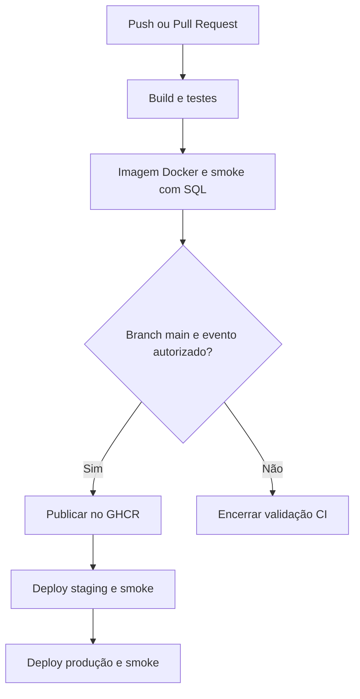

# Projeto - Cidades ESG Inteligentes | HydroGuard

Sistema de monitoramento de consumo de água, cadastro de medidores, alertas de possíveis vazamentos e indicadores ESG. API ASP.NET Core 8, frontend HTML/CSS/JavaScript e SQL Server.

**Integrantes:** preencher nomes completos e RMs em `docs/integrantes.txt` antes de entregar.

**Situação desta entrega:** implementação preparada; testes concentrados em C#; verificações estáticas executadas. Build .NET, testes xUnit, imagem Docker, pipeline GitHub e deploys externos ainda NÃO executados neste ambiente. Não há prints reais de staging/produção nesta versão. O checklist distingue arquivos implementados de execução comprovada.

## Como executar localmente com Docker

Pré-requisitos: Docker Engine/Docker Desktop com containers Linux e Docker Compose v2.24 ou superior; SDK .NET 8 para testes/smoke; Python 3.10+ apenas para geração opcional de .env/PDF; host x86-64. Para uma stack, reserve aproximadamente 4 GB de RAM para Docker; para duas stacks no mesmo host, planeje 8 GB como ponto de partida, ajustando conforme uso. São estimativas de dimensionamento, não medições deste projeto.

1. Extraia o ZIP e abra um terminal dentro da pasta `HydroGuard-main`.
2. Gere configuração local com senhas aleatórias (o script recusa sobrescrever `.env`):

```bash
python3 scripts/setup_env.py
```

No Windows, use `python` se `python3` não estiver disponível. Alternativa manual: copie `.env.example` para `.env` e substitua TODOS os valores com `SUBSTITUA`. Use senhas de pelo menos 12 caracteres e chave JWT aleatória de pelo menos 32 bytes. Para SQL/admin, use letras, números e símbolos `!@#%_+=.-`; evite espaços, aspas, `$` e `;` para evitar problemas de interpretação da configuração.

3. Inicie a stack:

```bash
docker compose -p hydroguard-local config --quiet
docker compose -p hydroguard-local up -d --build --wait --wait-timeout 300
docker compose -p hydroguard-local ps
```

4. Abra [interface local](http://localhost:5000), [Swagger](http://localhost:5000/swagger) e [readiness](http://localhost:5000/healthz).
5. Entre com usuário `admin` e a senha `ADMIN_PASSWORD` do seu `.env`. O seed local cria dados demonstrativos. Staging e produção criam somente admin, sem consumos fictícios.

O banco só é acessível pela rede Docker. Migrations são aplicadas no início da API, depois de o SQL Server ficar saudável. O health check da API inclui conexão ao banco. `/livez` verifica apenas o processo. Não use `/livez` para validar deploy.

```bash
# Parar sem apagar dados
docker compose -p hydroguard-local down
# Diagnóstico local (revise antes de compartilhar)
docker compose -p hydroguard-local logs --tail=100 api sqlserver
```

Não use `down --volumes` em staging/produção: remove os dados. O pipeline usa essa opção SOMENTE na stack temporária de CI.

### Executar testes

Com SDK .NET 8 instalado:

```bash
dotnet restore HydroGuard.sln
dotnet build HydroGuard.sln -c Release --no-restore
dotnet test tests/HydroGuard.Tests/HydroGuard.Tests.csproj -c Release --no-build --logger "trx;LogFileName=tests.trx" --results-directory TestResults
```

Também é possível executar xUnit dentro do SDK Docker, sem SDK instalado no host:

```bash
docker run --rm -v "${PWD}:/source" -w /source mcr.microsoft.com/dotnet/sdk:8.0 dotnet test tests/HydroGuard.Tests/HydroGuard.Tests.csproj -c Release
```

Todos os testes estão em C#. O projeto `HydroGuard.Tests` contém os 18 testes de integração existentes e 2 de health checks (20 no total), usando xUnit e EF InMemory. Não há testes Python. InMemory não valida SQL, migrations nem constraints relacionais; por isso o pipeline também sobe SQL Server real para smoke HTTP.

`tests/HydroGuard.SmokeTests` é um pequeno executável C# sem pacotes externos: verifica configuração, banco disponível via readiness, frontend, Swagger, 401 anônimo, login e rotas da API real. Ele não faz parte da contagem de 20 testes xUnit e só executa contra um ambiente iniciado. Retorna código 0 em sucesso e 1 em falha, bloqueando a promoção. Os resultados xUnit continuam sendo exportados em TRX.

Para smoke local, exporte a senha no terminal e execute o script (sem colocá-la no comando ou em prints). Em Bash, usando exclusivamente o `.env` gerado pelo script:

```bash
set -a
source .env
set +a
dotnet run --project tests/HydroGuard.SmokeTests -c Release -- http://127.0.0.1:5000 --expected-environment Development --expected-revision local --output evidence/local-smoke.json
```

Em PowerShell, defina `$env:ADMIN_PASSWORD` a partir do seu `.env` e execute o comando `dotnet run` acima com os mesmos argumentos.

## Pipeline CI/CD

Ferramenta: **GitHub Actions**. Registry: **GitHub Container Registry (GHCR)**. Workflow: `.github/workflows/ci-cd.yml`.

| Etapa | Onde executa | O que valida / realiza |
| --- | --- | --- |
| build-test | Runner GitHub Ubuntu 24.04 | Restore, build Release, 20 testes C# com xUnit; arquivo TRX e cobertura |
| container | Runner GitHub Ubuntu 24.04 | Build Docker, Compose com SQL Server real, readiness, frontend, Swagger, 401 anônimo, login JWT, medidores e ESG |
| publicação | Mesmo job container; somente main | Publica imagem com tag do commit e obtém referência imutável por digest SHA-256 |
| deploy-staging | Runner persistente com label hydroguard-staging | Pull da imagem, Compose, smoke; não recompila imagem |
| deploy-production | Runner persistente com label hydroguard-production | Executa após staging aprovado; usa exatamente o mesmo digest e smoke |



Pull requests executam CI e não publicam nem fazem deploy. Push em `main` e execução manual em `main` executam o fluxo completo. Falha bloqueia etapas dependentes. Produção é automática após staging: não configure revisores obrigatórios caso queira deployment contínuo sem aprovação manual. Pode-se adicionar aprovação posteriormente, mudando essa política.

**Importante:** o job `container` é um ambiente efêmero de testes; não substitui staging persistente. Nomes de GitHub Environments, por si só, não criam servidores.

### Configurar staging e produção de verdade

1. Publique o código em um repositório GitHub cuja branch principal seja `main`. Environments e secrets precisam estar disponíveis no plano/visibilidade escolhidos.
2. Disponibilize dois hosts Linux x64 persistentes, ou um host com recursos para duas stacks e dois processos de runner. Instale Docker, Compose v2.24+, Bash e Git. O workflow prepara o SDK .NET 8 com setup-dotnet em uma pasta temporária gravável pelo runner para executar o smoke C#; deploy manual exige o SDK instalado. O usuário do runner precisa executar Docker sem prompt interativo. O host precisa acessar GitHub, GHCR e Microsoft Container Registry.
3. Em **Settings > Actions > Runners > New self-hosted runner**, escolha Linux x64 e siga os comandos gerados pelo GitHub. Registre o primeiro com label `hydroguard-staging` e o segundo com `hydroguard-production`; instale/inicie cada runner como serviço. Em host único use pastas diferentes para cada runner. Os comandos/token são específicos do repositório; não os versione.
4. Em **Settings > Environments**, crie `staging` e `production`; restrinja deploy à branch `main` e acesso de escrita a colaboradores confiáveis. Os runners de deploy não executam jobs de pull request.
5. Cadastre os seguintes **secrets em CADA environment**, com valores diferentes entre ambientes:

| Secret | Uso |
| --- | --- |
| MSSQL_SA_PASSWORD | Senha do SQL Server; mínimo 12 caracteres, com maiúscula, minúscula, número e símbolo |
| JWT_KEY | Chave aleatória de pelo menos 32 bytes, por exemplo 64 caracteres hexadecimais |
| ADMIN_PASSWORD | Senha inicial do admin; mínimo 12 caracteres |

Para gerar valores com Python, use `secrets.token_hex(32)` para JWT e `"Hg!" + secrets.token_hex(20)` para senhas, em seu terminal local. Não publique a saída.

6. Configure as **variables** de cada environment:

| Variable | staging | production |
| --- | --- | --- |
| API_PORT | 5001 | 5000 |
| BIND_ADDRESS | 127.0.0.1 por padrão | 127.0.0.1 por padrão |
| APP_URL | URL real de acesso ao staging | URL real de acesso à produção |

`APP_URL` apenas cria um link no GitHub; não provisiona DNS nem proxy. Em host local, use `http://localhost:5001` e `http://localhost:5000`. Em VM, mantenha bind local e coloque um proxy HTTPS na frente, ou use túnel SSH para demonstração acadêmica. A configuração de domínio, TLS e proxy é uma tarefa da infraestrutura e não está provisionada neste pacote. O smoke do deploy valida o serviço no próprio host; se houver proxy, teste também a URL pública separadamente.

7. O workflow publica e baixa usando `GITHUB_TOKEN` com `packages:write`/`packages:read`. Não precisa criar PAT para esse fluxo. Se o pacote GHCR já existir, vincule-o ao repositório e confira **Manage Actions access** no pacote para liberar leitura/escrita ao repositório.
8. Faça push em `main`, abra **Actions > HydroGuard CI-CD** e acompanhe os quatro jobs. Se staging ficar em `Queued`, verifique runner online/labels. Produção só começa após staging bem-sucedido.
9. Acesse os dois ambientes, entre com a senha correspondente e capture as evidências indicadas abaixo.

### Isolamento e persistência

O script usa projetos Compose `hydroguard-staging` e `hydroguard-production`. Sem `container_name` fixo, cada projeto cria seus containers, redes e volume, como `hydroguard-staging_sqlserver_data` e `hydroguard-production_sqlserver_data`. Mesmo no mesmo host, bancos e portas são separados. Cada ambiente usa segredos distintos. Essa separação lógica é suficiente para uma demonstração; hosts separados oferecem maior isolamento.

As senhas iniciais são aplicadas apenas ao criar usuários/banco. Alterar secrets posteriormente não altera automaticamente a senha no volume existente. Planeje rotação no banco e no usuário, mantendo o smoke sincronizado. Não apague volumes como atalho para redefinir produção.

### Falhas e rollback

Se o smoke staging falhar, produção não é promovida. Se produção falhar, o job sinaliza falha, mas a versão recém-aplicada pode continuar rodando; não há rollback automático. Registre o digest anterior e execute novamente `scripts/deploy.sh` com `API_IMAGE` nesse digest e `APP_REVISION` no commit correspondente, mantendo os secrets do ambiente. Faça isso em terminal autorizado no host, com `DEPLOY_ENV=production`. Reverter imagem não reverte migrations: só use versão compatível com o schema atual e faça backup antes de mudanças de banco.

O modelo usa uma réplica da API por stack e migrations no startup. Pode haver breve indisponibilidade ao recriar o container. Não oferece zero downtime, alta disponibilidade, backup automático nem isolamento por namespace de Kubernetes. São evoluções além do escopo mínimo da atividade.

## Containerização

Dockerfile multi-stage: SDK restaura/publica a aplicação; imagem final contém runtime ASP.NET e curl para health checks, sem SDK nem código-fonte. A restauração precede a cópia do código para aproveitar cache. A API roda como usuário `app`, escuta porta 8080 e carrega segredos por variáveis em runtime. A revisão do commit é incluída na imagem e aparece em `/healthz`.

```dockerfile
# syntax=docker/dockerfile:1
FROM mcr.microsoft.com/dotnet/sdk:8.0 AS build
WORKDIR /source
COPY src/HydroGuard.API/HydroGuard.API.csproj src/HydroGuard.API/
RUN dotnet restore src/HydroGuard.API/HydroGuard.API.csproj
COPY src/HydroGuard.API/ src/HydroGuard.API/
RUN dotnet publish src/HydroGuard.API/HydroGuard.API.csproj -c Release --no-restore -o /app/publish /p:UseAppHost=false

FROM mcr.microsoft.com/dotnet/aspnet:8.0-bookworm-slim AS runtime
USER root
RUN apt-get update && apt-get install -y --no-install-recommends curl && rm -rf /var/lib/apt/lists/*
WORKDIR /app
COPY --from=build --chown=app:app /app/publish .
ARG APP_REVISION=local
ARG APP_SOURCE=
LABEL org.opencontainers.image.revision=$APP_REVISION org.opencontainers.image.source=$APP_SOURCE
ENV ASPNETCORE_URLS=http://+:8080 HydroGuard__Revision=$APP_REVISION
USER app
EXPOSE 8080
HEALTHCHECK --interval=15s --timeout=5s --start-period=60s --retries=10 CMD curl -fsS http://localhost:8080/healthz || exit 1
ENTRYPOINT ["dotnet", "HydroGuard.API.dll"]
```

O Compose orquestra API + SQL Server 2022 Express, volume persistente, rede de frontend e rede interna do banco. Não publica 1433. `depends_on: service_healthy` evita iniciar API antes do SQL estar pronto; `up --wait` aguarda também readiness da API.

Tag da imagem: `ghcr.io/<proprietario>/<repositorio>:<commit>`. Deploy: `ghcr.io/<proprietario>/<repositorio>@sha256:<digest>`. O valor real só será conhecido após publicação. A mesma imagem da aplicação é promovida entre ambientes. Tags das imagens-base e SQL são móveis; para reprodutibilidade integral, fixe seus digests após validar as versões.

## Prints do funcionamento

**Evidência real incluída:** `evidence/validacao-local.txt`, com verificações estáticas da versão com testes em C#. Ela NÃO comprova build .NET, Docker ou deploy.

**Ainda pendentes:** links das runs do GitHub, imagem GHCR, TRX, prints do pipeline, staging e produção. Preencha `docs/evidencias.md`, salve prints em `docs/prints/` e acrescente abaixo os links/imagens após executar. Antes disso, não marque deploy como concluído.

O workflow gera artifacts `test-results`, `container-evidence`, `staging-evidence` e `production-evidence`. Os arquivos smoke contêm ambiente, revisão, data e verificações, sem senha/token. Ausência de artifact ou job verde não substitui teste visual do frontend.

Prints exigidos:

1. Visão geral da execução Actions com build-test, container, deploy-staging e deploy-production.
2. Logs de build e testes com quantidade/resultados; registro do commit e digest publicado.
3. Logs de deploy e smoke staging; tela do staging e `/healthz` com `Staging` e revisão.
4. Logs de deploy e smoke produção; tela de produção e `/healthz` com `Production` e a mesma revisão.
5. Containers saudáveis e redes/volumes separados, sem expor secrets.

Nunca capture `.env`, GitHub Secrets, tokens de runner/login ou saída completa de `docker compose config`. Use `config --quiet` e `compose ps` para verificação segura.

## Tecnologias utilizadas

- C# e ASP.NET Core 8; Entity Framework Core 8 com migrations.
- SQL Server 2022 Express; BCrypt; autenticação JWT.
- HTML, CSS e JavaScript; Swagger/OpenAPI.
- xUnit, WebApplicationFactory, EF InMemory e Coverlet.
- Docker, Compose v2, GitHub Actions, GHCR e runners Linux x64.
- C#/.NET 8 para todos os testes e smoke HTTP; Bash para deploy.
- Python apenas nos geradores opcionais de `.env` e PDF; não é usado pelo pipeline.

## Estrutura e alterações

Código da API movido para `src/HydroGuard.API`, testes para `tests/HydroGuard.Tests`; solution e referência atualizadas. Dockerfile consolidado na raiz. Implementados workflow, scripts, configuração de exemplo, readiness/liveness, seed por ambiente e documentação. Testes Python removidos; pré-validação e smoke HTTP migrados para C#, sem novas dependências NuGet. GHCR preservado. A factory de testes usa banco com nome único e não registra SQL Server no ambiente Testing, evitando conflito entre providers e compartilhamento entre fixtures. Senhas públicas/fallbacks removidos; login não vem com senha preenchida.

Estrutura principal: `Dockerfile`, `docker-compose.yml`, `.env.example`, `HydroGuard.sln`, `src/`, `tests/`, `scripts/`, `.github/workflows/`, `docs/` e `evidence/`. O PDF técnico e seu checklist ficam em `docs/HydroGuard-Documentacao-CICD.pdf`.

## Desafios encontrados e soluções

| Desafio | Solução implementada | Verificação pendente |
| --- | --- | --- |
| Ambiente atual sem SDK/Docker | CI instala SDK e usa hosts com Docker | Executar build/test/container no GitHub |
| Senhas e chave JWT fixas no código | Secrets externos, geração aleatória e pré-validação | Configurar secrets reais |
| Conflito de providers e bancos de teste compartilhados | SQL não registrado em Testing; banco único por factory | Rodar 20 testes xUnit |
| API iniciando antes do SQL | Health check SQL, depends_on e readiness API | Rodar Compose real |
| Staging e produção colidindo | Projetos, portas, redes e volumes distintos | Confirmar nos hosts |
| Evidências externas indisponíveis | Roteiro e artifacts automatizados, pendências explícitas | Capturar prints reais |

## Referências técnicas

- [GitHub Actions: controle de deployments](https://docs.github.com/en/actions/how-tos/deploy/configure-and-manage-deployments/control-deployments)
- [GitHub: runners próprios](https://docs.github.com/en/actions/how-tos/manage-runners/self-hosted-runners/use-in-a-workflow)
- [GitHub Container Registry](https://docs.github.com/en/packages/working-with-a-github-packages-registry/working-with-the-container-registry)
- [Docker: ordem de inicialização](https://docs.docker.com/compose/how-tos/startup-order/)
- [Microsoft: SQL Server em containers](https://learn.microsoft.com/en-us/sql/linux/quickstart-install-connect-docker?view=sql-server-ver16)
- [Microsoft: testes de integração ASP.NET Core](https://learn.microsoft.com/en-us/aspnet/core/test/integration-tests?view=aspnetcore-8.0)

## Checklist de entrega (obrigatório)

- [x] Projeto compactado em ZIP com estrutura organizada e código-fonte completo.
- [x] Dockerfile implementado na raiz; execução funcional ainda pendente de validação.
- [x] docker-compose.yml com API, banco, variáveis, volume e redes.
- [x] Pipeline configurado com build, testes e deploy em dois ambientes; execução ainda pendente.
- [x] README com instruções e roteiro de evidências.
- [x] PDF técnico com arquitetura, desafios, checklist e registro de validação local.
- [ ] Build .NET e 20 testes xUnit executados e aprovados.
- [ ] Dockerfile/Compose executados com sucesso e imagem publicada no GHCR.
- [ ] Prints/links reais do pipeline adicionados ao README e PDF.
- [ ] Deploy realizado e comprovado em staging.
- [ ] Deploy realizado e comprovado em produção.
- [ ] Nomes completos e RMs preenchidos no README/PDF.

**O pacote ainda não satisfaz a entrega final completa enquanto os itens pendentes não forem executados e documentados.**
